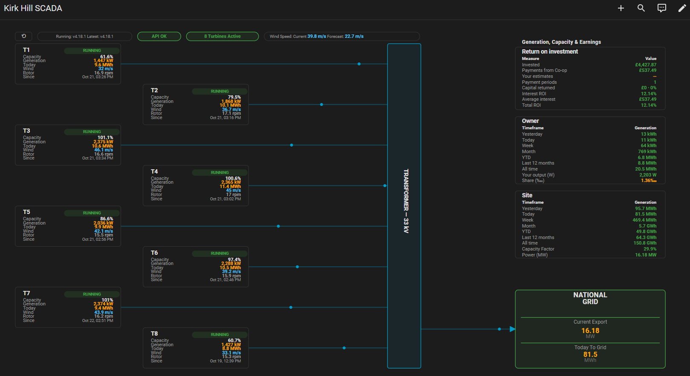
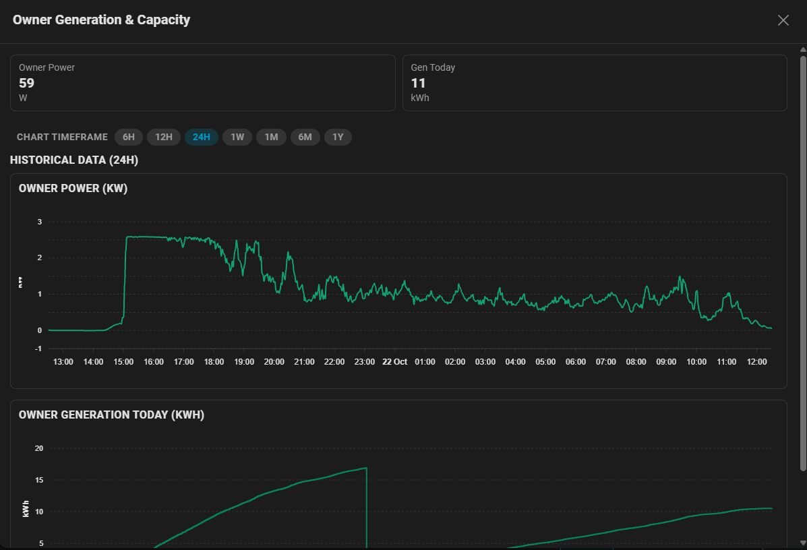
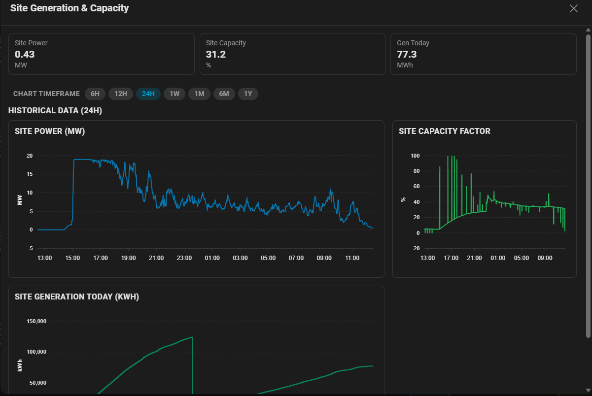
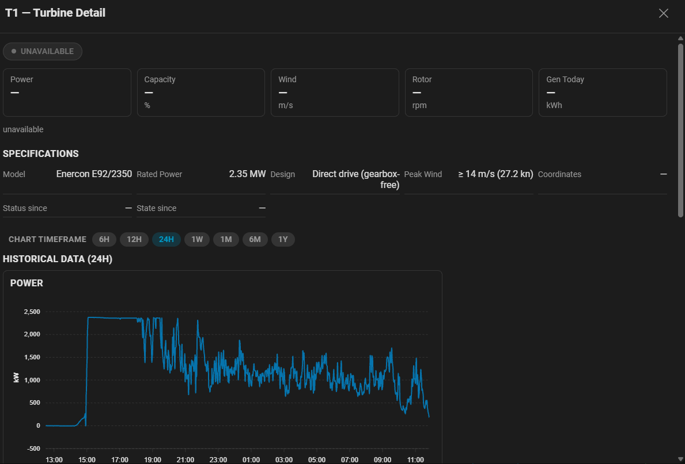
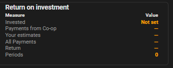
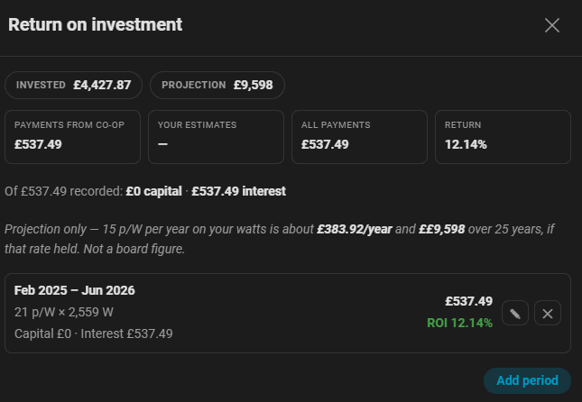
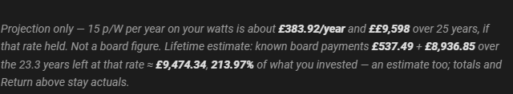
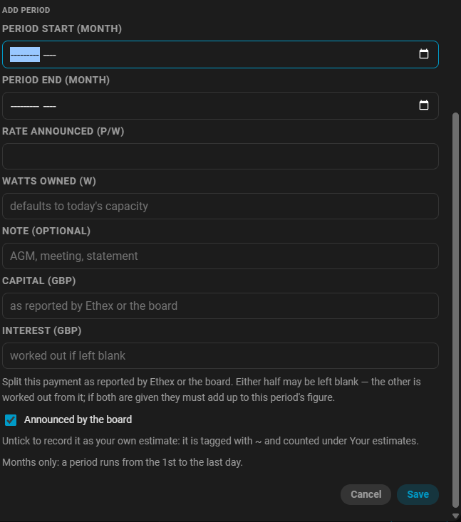
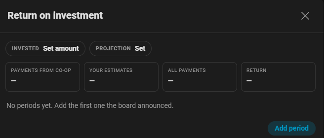

# Dashboard

When you add the integration, it can auto-create a Lovelace dashboard tab
(`kirk-hill-wind-dashboard`) in the sidebar.

## Kirk Hill SCADA tab

The first (and, since v4.8.80, only) tab — titled **Kirk Hill SCADA**: a
full-bleed animated single-line diagram of the farm — 8
turbines feeding the site collection bus, through the step-up transformer, into
the national grid. Each turbine shows live power, colour-coded status, last
status time, today's generation and rotor speed; flow dots animate in proportion
to power. The national grid block shows **Owner and Site** export power and
to-grid-today side by side, the header shows live wind, active-turbine and
next-hour forecast chips. Your **share of bought watts** is shown in per-myriad
(‱) form (e.g. `1.36‱`) via the owner-share entity, falling back to the observed
generation ratio if that entity is unavailable. Rendered as a panel view so it
fills the entire tab.



### Turbine status chip

The **turbine status chip** (fourth in the top chip row) shows how many
turbines are currently active — for example `8 Turbines Active` — in
three-tier colours driven by the active-turbine count:

- **Green** — every turbine is active.
- **Amber** — some turbines are offline.
- **Red, flashing** — every turbine is offline.

Clicking the chip opens a per-turbine status pop-out. Faults are a separate
matter: the **Alarm** binary sensor (`binary_sensor.<farm>_alarm`) turns on
only when a turbine reports a thermal or electrical fault (`status_category`
of `fault_thermal` or `fault_electrical`) — see [Sensors](sensors.md).

### Turbine status pills

Each **turbine status pill** (on the turbine node) shows the individual
turbine's operational state: RUNNING, READY, STARTING, CURTAILED, NO WIND,
STOPPED, MAINTENANCE, UNAVAILABLE, or a fault label. The pill background is a
pastel tint of the status colour; the text is the saturated status colour.

A turbine can be **curtailed** (bird/bat protection, grid constraint, etc.)
while the **Alarm** binary sensor still reads off — curtailment is not a
fault.

### API status pill

In the top chip row of the SCADA card, third from the left
(⟲ · version · API · turbines active · wind). Reflects the coordinator's last
fetch directly, so an API outage is obvious rather than a page full of unknown
values:

- **API OK** (green) — the Kirk Hill API last responded normally.
- **API DOWN** (red, flashing) — the coordinator's last fetch failed (timeout,
  rate-limit, or outage).
- **API —** — the status entity is unavailable or not configured.

The card also has a fourth state, **API LIMITED** (amber), which activates
once the API status entity exposes a `rate_limited` attribute — the frontend
is wired for it, but the backend does not report it yet. Clicking the pill
opens an API status pop-out with the recent history.

### Restored generation values

After a Home Assistant restart, generation figures (yesterday, today, week,
month, YTD, year, all time) are restored from the last known cached values
while waiting for the next API fetch. Restored values are shown at **50%
opacity** so you can distinguish them from live API reads. Once the integration
fetches fresh data, the opacity returns to normal.

### Per-pop-out chart timeframe control

Each **Owner** and **Site** detail modal (and every turbine pop-out) has its own
timeframe selector offering **6H / 12H / 24H / 1W / 1M / 6M / 1Y** (24H
default). The selected range is remembered per pop-out type (owner, site,
turbine) and drives that modal's charts independently — there is no single
global timeframe control. Modal headings show the active range (e.g.
"Historical Data (1W)"). Windows longer than a week (1M / 6M / 1Y) use hourly
recorder statistics rather than raw history, so the charts stay usable on
slower browsers.

### Site, Owner and Wind detail modals

Clicking a **Capacity** panel (Owner or Site) opens a dedicated detail modal for
the scope you clicked — a separate **Site** modal and a separate **Owner** modal,
each with its own ApexCharts series for the selected timeframe. Clicking the
**Wind** panel opens a **Wind Speed** modal showing current wind speed, the
one-hour forecast, and the live difference. All clickable panels have a
cursor/hover affordance to signal they are clickable.





### Turbine detail modal

Clicking a turbine node opens its pop-out. Besides power, wind, rotor, capacity
and generation charts for the selected timeframe, the modal includes a
**turbine activity swimlane** — one labelled row per state the turbine was in
during the window (running, curtailed, in maintenance, stopped, in a fault
state, etc.) with a coloured block for each continuous stretch, so state changes
and their durations read at a glance. Hovering a block shows its start/stop time
and duration.



## Financials (formerly the Finances tab)

!!! note "Money is a panel on the SCADA card, not a column"
    **2026-10-09** — the £ column, the £/h cells, the price pills and the
    member-savings line were switched off while the model was confirmed, and
    deliberately left drawn-but-empty as a standing reminder.

    **2026-10-21 — the column is gone and a panel took its place.** The Owner
    and Site panels carry generation only; money lives in a **Return on
    investment** panel, drawn with the same box, columns and styling as those
    two, at the **top of the right column, above Owner and Site**. Click it for
    the full ledger and its forms. The 22 earnings entities stay disabled and
    zeroed, and nothing else on the card reads them.

### Return on investment (top panel of the right column)

Same geometry as the Owner and Site panels — the same box, right-aligned to
the value column — carrying the headline only:

| Measure | Value |
| --- | --- |
| Invested | `£5,000` in **green** — the colour for a figure you typed yourself — or `Not set` until you enter it |
| Payments from Co-op | `£1,074.98` |
| Your estimates | `—` until one exists |
| All Payments | `£1,074.98` |
| Return | `21.50%`, or `—` with no capital entered |
| Periods | `2` |

Two rows were dropped from the panel in favour of the modal: **Published
rate** — it sits on every row there, and only board records ever set it — and
**Current period**, which is blank whenever a period is undeclared while the
modal's caption can also say *who* declared it (board or you).



**Clicking the panel opens the ledger modal**, which holds everything else:



- **Rows** — one per declared period, e.g.
  `Feb 2025 – Jun 2026 · 21 p/W × 2,559 W · £537.49 · ROI 10.75%`, each with
  edit and remove, plus **Add period**.
- **Return is a plain percentage of capital**: `value ÷ invested × 100` per
  period and across the total. It is deliberately **not annualised** — the
  board pays per period regardless of how long it runs, so a per-year figure
  would be a rate of our own invention. With no capital entered the ROI reads
  `—`, never `0%`.
- **Invested** — set or cleared in the modal; stored in the ledger's Store,
  never `entry.options`. It and its modal input show **green whenever you have
  entered it** — every path that can set it is yours, so "has a value" and
  "inputted by the user" are the same statement — while an unset figure keeps
  the normal colour and says `Not set`. The form also quotes the **derived
  share value** beside the input once both halves exist: *≈ £1.7300/W ×
  2,559.465 W* (`invested ÷ watts`, recomputed live, and it writes nothing
  back).
- **Capital and interest** — each period can carry the split as an Ethex
  statement or a board announcement reports it: enter either half (the other is
  worked out from the period's figure) or both (they must sum to it **to the
  penny**, or the save is refused). Rows show
  `Capital £400.00 · Interest £137.49`, and a line under the totals sums them
  across every period. Nothing derives a split — it is entered by hand, and a
  period with no split shows none.
- **Projection** — a labelled one-liner, never a figure. Enter an annual p/W
  rate — normally the board's own published equivalent, whose Feb 2025 → Jun
  2026 announcement equated 21 p/W over 17 months to **15 p/W over a year** —
  and a lifespan, and the modal shows *"Projection only — 15.00 p/W per year
  on your watts is about £383.92/year and £9,598.00 over 25 years, if that rate
  held. Not a board figure."* It fills no period, feeds no total and changes no
  ROI; clear it from the same form. The same line ends with the **lifetime
  estimate** — *known board payments £537.49 + £8,937.90 over the 23.3 years
  left at that rate ≈ £9,475.39, ≈ 213.99% of what you invested — an estimate
  too; totals and Return above stay actuals.* That is the board's actuals plus
  **time-left**: elapsed runs fractionally from the first board period, and
  the rate is whatever you last set in the form — never a constant in the
  code, because the board can requote. Exposed as `lifetime_estimate_gbp`,
  `lifetime_roi_pct` and `lifetime_remaining_years`; it fills no period, feeds
  no total and changes no ROI, exactly like the projection it rides on.

  
- **A caption under the rows** says which of two things the current period is:
  **announced by the board**, or **your own estimate**. An undeclared period
  shows no figure — the estimate is withheld, never invented — but the caption
  still states the situation: *awaiting the board's next declaration* (a
  declaration brings the rate and the capital/interest split together).
- **Adding a period opens prefilled** with the month after the latest one ends —
  Feb 2025 → Jun 2026 offers **`2026-07`** — and the end month left blank, since
  when the board's next period closes is not ours to guess.

  

With no periods yet the modal says so instead of showing numbers:



An `roi` **tab** existed for part of 2026-10-21; it was replaced by this panel
and is listed in `OBSOLETE_VIEW_PATHS`, so installed dashboards have it pruned
on the next setup.

#### The ledger behind it

- **Each line item is a run of whole months plus the rate** —
  `{start month, end month, rate p/W, watts owned, note, source, capital,
  interest}`. The figure
  for a line is `watts × p/W ÷ 100`; the period only says *which* declaration
  applies, never how long money accrues for. A period is stored as the **1st to
  the last day** of its months, so "Feb 2025 – Jun 2026" means exactly those
  months whatever dates were picked.
- **`source` is `board` or `self`.** The form's *Announced by the board* box
  is pre-ticked; untick it to record your own estimate for a period the board
  has not covered. Records predating the field normalise to `board`. The total
  still sums both — `board_total_gbp` / `self_total_gbp` say how much of it was
  announced — your-estimate rows are dashed, tagged `your estimate` and
  `~`-prefixed, and **only board records feed the published rate**: your
  estimate is not a published figure.
- **Storage and writes** — one Store file per config entry (never
  `entry.options`: config-entry migrations purge monetary keys there). Changed
  only through `kirkhill_wind.add_payment_record`, `update_payment_record`,
  `remove_payment_record`, `set_invested_amount` and `set_projection`; the card
  never writes storage itself.
- **`sensor.<farm>_payment_ledger`** exposes `records` (each with `value_gbp`,
  `roi_pct`, `capital_gbp` and `interest_gbp`), `total_gbp`,
  `board_total_gbp`, `self_total_gbp`, `capital_total_gbp`,
  `interest_total_gbp`, `invested_gbp`, `total_roi_pct`,
  `annual_rate_p_per_w`, `lifespan_years`, `annual_gbp`, `lifespan_gbp`,
  `share_value_gbp_per_w`, `lifetime_estimate_gbp`, `lifetime_roi_pct`,
  `lifetime_remaining_years`,
  `latest_rate_p_per_w`, `latest_board_rate_p_per_w`, `current_gbp`,
  `current_basis` (`declared` · `awaiting_next_declaration` ·
  `no_entries`), `current_source`, `current_year_gbp` and `year_totals_gbp`.

#### Board announcements shipped in the repo

Board figures can be entered without touching the UI: the integration ships
`custom_components/kirkhill_wind/board_announcements.yaml`, and every entry in
it is **upserted into the ledger as a board record on setup**.

```yaml
records:
  - period_start: 2025-02-01
    period_end: 2026-06-30
    rate_p_per_w: 21
    announced_on: 2025-07-15
    note: "£1.6m member payment approved — 21 p/W for the 17-month period"
```

- **Switchable to manual.** Options → **Board figures source** chooses between
  **Repo file — board_announcements.yaml** (default) and **Manual entry
  only**; manual ignores the file entirely and makes the card the only writer.
  Going manual does not remove figures the file already brought in, and coming
  back re-applies it.
- **Edit it in a pull request** — `git log` then records who entered which
  figure and when, and the install picks the change up on the next setup or a
  `kirkhill_wind.reload_integration` call: no code deploy.
- **Matching is by period**, so re-announcing a period with a new rate updates
  that record in place (keeping the watts and any capital/interest split
  already entered against it) and creates nothing new. Periods the file does
  not name — anything you added in the card — are never touched.
- **A new period takes the API's current owner capacity**, because the board
  announces a rate, not your watts; with no capacity available the record is
  skipped with a warning rather than guessed.
- **The board's figure wins on a re-announcement**: if the new rate makes an
  entered capital/interest split impossible, the split is cleared and the log
  says so — a wrong split is never kept silently.

### What the Owner and Site panels no longer show

- Gone from both panels: the **`Value (£)` column**, the **`£/h`** cells, the
  **Member savings** line and both **price pills**. Generation now takes the
  right-hand edge of each panel instead of leaving the old money column's gap.
- **The timeframe rows stay moneyless on purpose.** `Yesterday … Year` are
  `kWh × price` sensors that remain disabled, and slicing a per-watt
  declaration across days would be the accrual the board's basis rules out —
  see [Development decisions](development/decisions.md). The ledger still
  exposes `current_year_gbp` / `year_totals_gbp` (declarations attributed whole
  to the year they *end* in) for templates.

### Prices and member savings (entities present, disabled, unused by the cards)

`number.<farm>_owner_rate_p_w`, `number.<farm>_owner_price_p_kwh`,
`number.<farm>_negotiated_price_gbp_mwh` and
`sensor.<farm>_member_savings_value` still exist, **disabled and set to
`0.0`**. They feed no card any more: rates live per declared period in the
ledger. Re-enable one with `hab entity enable <entity_id>` if you want it for
something else — nothing on the card will change. The suppression rule for
valuing history as `kWh × today's price` still stands for those sensors
themselves (see [Sensors](sensors.md)).

## History tab

**Removed in v4.8.77.** The 25-hour owner/site power and wind charts it held
are covered by the SCADA card's Owner and Site pop-out modals, which offer
selectable 6H–1Y timeframes. Data previously here is available through those
modals; the dedicated tab no longer exists.

## Turbines tab

**Removed in v4.8.80.** The standalone Turbines view (turbine map and per-turbine
status overview) has been deleted. Live per-turbine status, power, and generation
today are shown on the SCADA diagram, and per-turbine history is available through
each turbine's pop-out modal. Dashboards with the old `turbines` view are pruned
automatically on merge.

The standalone **turbine map card** (`kirkhill-wind-turbine-map`) was
**deprecated** as of v4.8.81 and its JavaScript has since been removed: it no
longer renders, and installed dashboards carrying it are pruned as obsolete on
the next setup. Use the **Kirk Hill SCADA** card instead.

The turbine map card previously provided:
- T1–T8 labels above each turbine marker
- Turbine icons that spin in proportion to live site capacity factor
- Active/inactive state shown by marker colour
- Running/stopped legend and per-turbine hover title
- Fixed zoom level (15) centred on the farm
- Scroll wheel zoom, drag-to-pan, pinch zoom, double-click/double-tap to reset
- Tiles served by **OpenStreetMap** (standard tile URL `tile.openstreetmap.org/{z}/{x}/{y}.png`); the map previously used CARTO Voyager tiles (v4.8.76–v4.8.78) but has been reverted to OSM for reliability on all networks

The per-turbine status cards and the all-turbine activity graph were removed in
v4.8.77 — turbine power, status, and activity history are now shown on the SCADA
diagram and via each turbine's pop-out modal.

## Dashboard customisation

User-added cards, sections, and views are **preserved** across integration
reloads and updates. The integration only updates the cards it manages —
anything you add yourself is kept, and removed default cards are pruned without
touching your additions.

## Factory reset the dashboard

Your customisations stay until you **explicitly** wipe them. There are two ways
to start over:

**Option 1 — untick and rebuild from the integration**

1. Go to **Settings → Devices & Services → Kirk Hill Wind Farm → Configure**.
2. **Untick "Create dashboard automatically"** and save — the integration stops managing the dashboard, so nothing can be overwritten.
3. In the dashboard editor, **delete the `Kirk Hill Wind Farm` tab**.
4. **Re-tick "Create dashboard automatically"** (or reload the integration) — a fresh default dashboard is generated.

**Option 2 — reset immediately**

Call the `kirkhill_wind.reset_dashboard` service:

```yaml
service: kirkhill_wind.reset_dashboard
```

This restores the dashboard to the integration defaults and **discards all
customisations**.

## Bundled chart cards

The ApexCharts and Plotly Lovelace cards are bundled with the integration and
registered automatically. No separate HACS installation is required for the
dashboard charts.

## Frontend cards

The animated SCADA card, turbine map card, and chart cards are bundled by the
integration and loaded automatically with the dashboard. The frontend cards are
reloaded automatically whenever the integration starts or is reloaded — no
manual page refresh or HA restart required.

For manual import or customization, a dashboard YAML is also provided at
[`dashboards/kirkhill_wind_scada.yaml`][dashboard-yaml].

[dashboard-yaml]: https://github.com/MJP-76/KirkHillWindFarm/blob/main/dashboards/kirkhill_wind_scada.yaml
